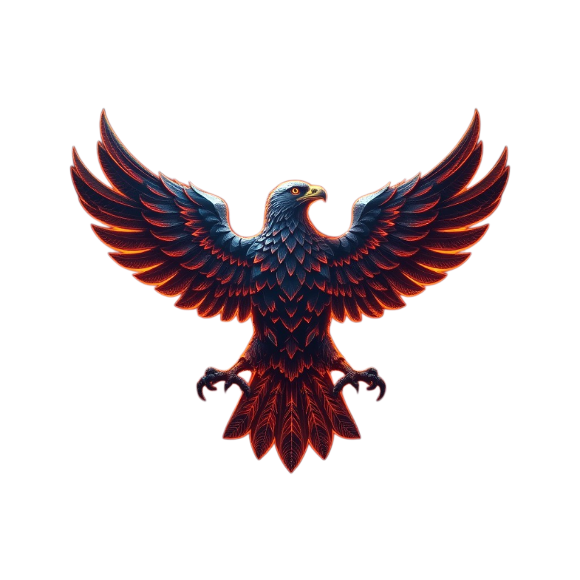

<p align="center">
  
</p>

<h1 align="center">AlertHawk</h1>

<p align="center">
  <strong>Self-hosted monitoring for APIs, websites, servers, Kubernetes, and more</strong>
</p>

<p align="center">
  <a href="https://alerthawk.net">Live demo</a> ·
  <a href="https://github.com/thiagoloureiro/AlertHawk/tree/main/AlertHawk.Docs">Docs</a> ·
  <a href="https://artifacthub.io/packages/search?repo=alerthawk">Helm charts</a> ·
  <a href="https://github.com/thiagoloureiro/AlertHawk.Chart">Chart repo</a>
</p>

<p align="center">
  <a href="https://github.com/thiagoloureiro/AlertHawk/blob/main/LICENSE"></a>
  <a href="https://dotnet.microsoft.com/"></a>
  <a href="https://alerthawk.net"></a>
  <a href="https://github.com/thiagoloureiro/AlertHawk/stargazers"></a>
  <a href="https://github.com/thiagoloureiro/AlertHawk/network/members"></a>
  <a href="https://github.com/thiagoloureiro/AlertHawk/issues"></a>
  <a href="https://github.com/thiagoloureiro/AlertHawk/commits/main"></a>
  <a href="https://app.codacy.com/gh/thiagoloureiro/AlertHawk/dashboard?utm_source=gh&utm_medium=referral&utm_content=&utm_campaign=Badge_grade"></a>
  <a href="https://ko-fi.com/thiagoloureiro"></a>
</p>

---

## Overview

**AlertHawk** is a self-hosted monitoring platform that gives you real-time visibility into the health and performance of your stack. Monitor WebAPIs, websites, TCP endpoints, Kubernetes clusters, and more — with alerts delivered through the channels you already use.

**Try it now:** [https://alerthawk.net](https://alerthawk.net) — create an account or sign in with a personal Microsoft account.

## Features

- **Versatile monitoring** — HTTP/HTTPS, TCP, Kubernetes nodes/pods, and more
- **Microservices architecture** — modular services for availability and scale
- **Cloud & on-prem ready** — run anywhere you can host containers
- **Rich notifications** — email, Slack, Teams, Telegram, webhooks, and more
- **Metrics & FinOps** — cluster metrics plus Azure cost and resource insights
- **Kubernetes-native** — Helm charts on [Artifact Hub](https://artifacthub.io/packages/search?repo=alerthawk)

## Architecture

| Component | Description |
|-----------|-------------|
| **Authentication** | Identity and access (e.g. Microsoft Account / Azure AD) |
| **Monitoring** | Runs monitors (HTTP, TCP, K8s, etc.) and manages alerts |
| **Notification** | Delivers alerts to configured channels |
| **Metrics Agent** | Collects metrics from your environments |
| **Metrics API** | Stores and queries metrics data |
| **FinOps** | Azure cost/resource analysis with optional AI recommendations |
| **UI** | Web dashboard |

Architecture diagram: [Diagrams/AlertHawk.drawio](Diagrams/AlertHawk.drawio)

## Screenshots

<p align="center">
  
</p>

<p align="center">
  
  
</p>

<p align="center">
  
  
</p>

<p align="center">
  
</p>

## Quick start (Helm)

```bash
helm repo add alerthawk https://thiagoloureiro.github.io/AlertHawk.Chart/
helm repo update

helm show values alerthawk/alerthawk > my-values.yaml
# Edit my-values.yaml with your connection strings and secrets

helm install alerthawk alerthawk/alerthawk -f my-values.yaml
```

More details: [Helm docs](AlertHawk.Docs/helm/index.md) · [AlertHawk.Chart](https://github.com/thiagoloureiro/AlertHawk.Chart)

## Docker images & CI

Images are published to Docker Hub under [`thiagoguaru`](https://hub.docker.com/u/thiagoguaru).

### Notification

[](https://hub.docker.com/r/thiagoguaru/alerthawk.notification)
[](https://hub.docker.com/r/thiagoguaru/alerthawk.notification)
[](https://thiagoguaru.visualstudio.com/AlertHawk/_build/latest?definitionId=10)


### Authentication

[](https://hub.docker.com/r/thiagoguaru/alerthawk.authentication)
[](https://hub.docker.com/r/thiagoguaru/alerthawk.authentication)
[](https://thiagoguaru.visualstudio.com/AlertHawk/_build/latest?definitionId=14)


### Monitoring

[](https://hub.docker.com/r/thiagoguaru/alerthawk.monitoring)
[](https://hub.docker.com/r/thiagoguaru/alerthawk.monitoring)
[](https://thiagoguaru.visualstudio.com/AlertHawk/_build/latest?definitionId=11)


### Metrics

[](https://hub.docker.com/r/thiagoguaru/alerthawk.metrics.api)
[](https://hub.docker.com/r/thiagoguaru/alerthawk.metrics.api)
[](https://hub.docker.com/r/thiagoguaru/alerthawk.metrics)
[](https://hub.docker.com/r/thiagoguaru/alerthawk.metrics)
[](https://dev.azure.com/thiagoguaru/AlertHawk/_build/latest?definitionId=54)


### FinOps

[](https://hub.docker.com/r/thiagoguaru/alerthawk.finops.api)
[](https://hub.docker.com/r/thiagoguaru/alerthawk.finops.api)
[](https://thiagoguaru.visualstudio.com/AlertHawk/_build/latest?definitionId=65)


## Documentation

| Topic | Link |
|-------|------|
| Introduction | [AlertHawk.Docs/intro.md](AlertHawk.Docs/intro.md) |
| Monitoring | [AlertHawk.Docs/monitoring](AlertHawk.Docs/monitoring) |
| Notification | [AlertHawk.Docs/notification](AlertHawk.Docs/notification) |
| Authentication | [AlertHawk.Docs/authentication](AlertHawk.Docs/authentication) |
| Metrics API / Agent | [AlertHawk.Docs/metrics-api](AlertHawk.Docs/metrics-api) · [metrics-agent](AlertHawk.Docs/metrics-agent) |
| FinOps | [AlertHawk.Docs/finops](AlertHawk.Docs/finops) |
| Helm | [AlertHawk.Docs/helm](AlertHawk.Docs/helm) |

## Contributors

Thanks to everyone who has contributed:

| [](https://github.com/BulandaK) | [](https://github.com/altughan09) | [](https://github.com/guilhermedclima) | [](https://github.com/pvinicius) |
|:---:|:---:|:---:|:---:|
| [BulandaK](https://github.com/BulandaK) | [altughan09](https://github.com/altughan09) | [guilhermedclima](https://github.com/guilhermedclima) | [pvinicius](https://github.com/pvinicius) |

Full list: [contributors](https://github.com/thiagoloureiro/AlertHawk/graphs/contributors)

## License

This project is licensed under the [MIT License](LICENSE).

Support the project on [Ko-fi](https://ko-fi.com/thiagoloureiro).
